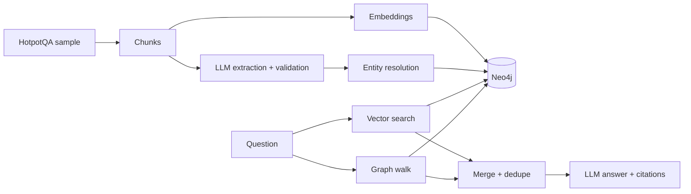

# GraphRAG: Knowledge-Graph-Augmented Retrieval for Multi-Hop Question Answering

A final-year project that measures whether adding a knowledge graph to ordinary
vector retrieval improves answers to questions that need facts from several documents.

## The problem

Example: "Where was the director of the film starring actor X born?" needs a chain of
facts spread over different paragraphs. Vector search finds paragraphs that *sound like*
the question, so it often finds only one link of the chain.

## What was built

1. **Vector RAG baseline**: paragraphs are embedded (all-MiniLM-L6-v2 via fastembed),
   stored in a Neo4j vector index, and the top-k are sent to Claude Haiku 5.5 to answer
   with citations. The model must answer "insufficient evidence" when the text is not enough.
2. **Knowledge graph**: Claude extracts entities and relations from each paragraph.
   Every relation must carry an evidence sentence that really appears in the paragraph;
   otherwise it is discarded. Names are merged only when identical after safe cleaning
   (case, accents, punctuation, "The", company endings).
3. **Hybrid retrieval**: vector top-5, plus up to 3 extra paragraphs found by walking the
   graph from entities named in the question (1 or 2 steps), skipping very popular entities
   and ranking extras by similarity to the question.
4. **Evaluation**: Exact Match, token F1, evidence recall, latency and cost, on held-out
   questions, with a fair control (vector search with the same number of paragraphs).

## Architecture



Graph schema: `(:Chunk)-[:MENTIONS]->(:Entity)`, `(:Chunk)-[:ABOUT]->(:Entity)`,
`(:Entity)-[:RELATION {predicate, evidence, chunk_id}]->(:Entity)`.

## Data

HotpotQA (distractor setting, validation split), Hugging Face copy `hotpotqa/hotpot_qa`,
license CC BY-SA 4.0. A fixed sample of 50 questions (seed 42): 15 development questions
used for choosing settings, 35 test questions used for the final numbers. This gives 500
paragraphs (one paragraph = one chunk).

## Results (35 test questions)

| System | EM | F1 | Evidence recall | All evidence found |
|---|---|---|---|---|
| Vector k=5 (baseline) | 0.371 | 0.537 | 0.786 | 0.600 |
| Vector k=8 (control) | 0.429 | 0.583 | 0.871 | 0.743 |
| Graph only (depth 2) | 0.371 | 0.489 | 0.643 | 0.457 |
| Hybrid, depth 1 | 0.486 | 0.670 | 0.886 | 0.800 |
| Hybrid, depth 2 | 0.429 | 0.608 | 0.886 | 0.800 |

Depth 2 was chosen on the development set; depth 1 happened to score higher on the test
set. Both are reported, and the choice was not changed after seeing test results.

Full tables, per-question outputs, and examples where the graph helped or hurt are in
`evaluation_results/` (`comparison.md`, `comparison.csv`, `*.jsonl`).

**Reading the results honestly**

- Hybrid found all needed evidence for 28 of 35 questions, versus 26 for vector search
  with the same number of paragraphs and 21 for the original baseline. The gain over the
  control is about two questions, so it is a consistent direction on a small sample, not
  a statistically proven improvement.
- Part of the improvement over the baseline comes simply from giving the model more text.
- Graph-only retrieval is worse than vector retrieval; the combination is what helps.
- The graph can add noise: on one comparison question, graph walking added unrelated
  paragraphs and the model answered wrongly. Depth 2 lowered scores on the 6 comparison
  questions.
- When the graph adds nothing, hybrid sends 5 paragraphs while the control sends 8.
- Cost: a one-time extraction of about $0.21 (3 of 500 paragraphs failed to extract).
  Query latency stayed around 1.5 seconds per question.

## Limitations

- Small evaluation (35 test questions) and a small corpus (500 paragraphs), which is
  easier than real-world retrieval.
- Extraction is done by an LLM and can be wrong or incomplete; many candidate relations
  were dropped for missing evidence. The graph is a derived representation; the original
  text is the source of truth.
- Entity merging is deliberately conservative, so some duplicates remain.
- Exact Match penalises correct answers with extra words; F1 is more informative here.
- No reranking, question decomposition, or public deployment yet.

## Setup

```bash
python3 -m venv .venv && source .venv/bin/activate
pip install -r requirements.txt
cp .env.example .env        # then edit .env; never commit it
docker compose up -d        # starts Neo4j (wait about 30 seconds)
```

## Reproduce

```bash
python -c "from huggingface_hub import hf_hub_download; hf_hub_download('hotpotqa/hotpot_qa', 'distractor/validation-00000-of-00001.parquet', repo_type='dataset', local_dir='data/raw')"
python -m scripts.prepare_sample        # 50 questions, 500 chunks
python -m scripts.build_index           # embeddings + Neo4j vector index
python -m scripts.extract_graph         # LLM extraction (about $0.20 with Claude Haiku 5.5)
python -m scripts.build_graph           # entity resolution + graph
python -m scripts.link_titles           # paragraph -> entity links
python -m scripts.run_eval --strategy vector --split test --k 5
python -m scripts.run_eval --strategy vector --split test --k 8
python -m scripts.run_eval --strategy hybrid --split test --depth 2
python -m scripts.compare
python -m pytest -q
```

## Project structure

- `app/` retrieval, generation, extraction, entity resolution, metrics
- `scripts/` data preparation, indexing, graph building, evaluation
- `tests/` unit tests (no API or database needed)
- `evaluation_results/` saved per-question results and summaries

## Credits

HotpotQA (Yang et al., 2018), Neo4j, fastembed with all-MiniLM-L6-v2, Claude Haiku 5.5.
